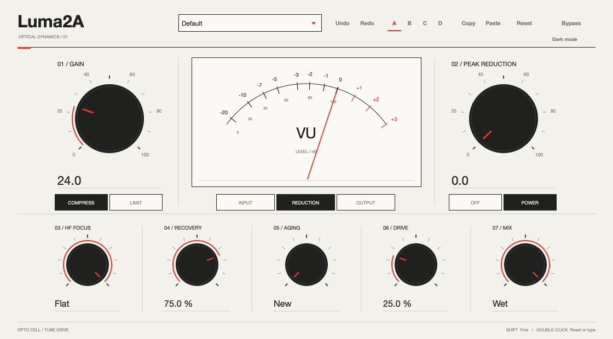

# Luma2A

Optical compression and tube saturation with a Swiss-inspired interface. Available as VST3, Audio Unit and a standalone application on macOS, and VST3 on Windows.



## Controls

Gain and Peak Reduction set makeup gain and compression. Recovery, Aging and HF Focus shape the optical response; Compress/Limit changes the compression curve. Drive adds compensated tube saturation, and Mix blends processed audio with the dry signal. The VU meter displays input, gain reduction or output.

- 85 factory presets and four comparison banks (A–D)
- Undo/redo, copy/paste and reset
- Light and [dark themes](docs/editor-dark.png), saved with the plugin session
- Mono and stereo processing, with float and double precision support
- 32-sample latency, including power-off and bypass modes

Drag a knob, scroll, or use the arrow keys to adjust it. Hold Shift for fine adjustment. Double-click a knob to reset it, or its label/value to enter an exact value.

## Build

Requires CMake 3.22+, a C++17 compiler and JUCE 8.0.10. CMake fetches the pinned JUCE release automatically, or accepts a local checkout through `JUCE_SOURCE_DIR`.

```sh
cmake -S . -B build -DCMAKE_BUILD_TYPE=Release
cmake --build build --config Release --parallel 6
ctest --test-dir build -C Release --output-on-failure
```

For a local JUCE checkout, add `-DJUCE_SOURCE_DIR=/path/to/JUCE` to the configure command. For a universal macOS build, add `-DCMAKE_OSX_ARCHITECTURES="arm64;x86_64"`.

Build outputs are under `build/Luma2A_artefacts/Release/`:

| Format | Bundle |
| --- | --- |
| VST3 | `VST3/Luma2A.vst3` |
| Audio Unit (macOS) | `AU/Luma2A.component` |
| Standalone | `Standalone/Luma2A.app` on macOS |

macOS bundles are ad hoc signed. Builds remain in the project directory until installed manually.

Windows builds support Visual Studio and CMake. An optional LLVM cross-build toolchain is provided in `tools/windows-clang-msvc.cmake`; `tools/build-windows.py --help` lists its SDK and compiler options.

## Automated builds

[GitHub Actions](https://github.com/D35P4C1T0/LUMA2A/actions/workflows/build.yml) builds and tests every push and pull request, and can also be started manually. Download the platform artifacts from a successful workflow run:

| Platform | Architecture | Formats |
| --- | --- | --- |
| macOS | Apple Silicon + Intel (universal) | VST3, Audio Unit, standalone |
| Linux | x86_64 | VST3, standalone |
| Windows | x86_64 | VST3, standalone |

Archives preserve plugin bundle structure and executable permissions. Artifacts are retained for 30 days. macOS builds are ad hoc signed.

Version tags also publish the validated platform archives to GitHub Releases.

## Install on macOS

Copy `Luma2A.vst3` to `~/Library/Audio/Plug-Ins/VST3/` and `Luma2A.component` to `~/Library/Audio/Plug-Ins/Components/`. Replace previous installed versions, then restart your host and rescan plugins.

## Tests

`ModelChecks` checks block independence, reset, in-place processing, finite output and bypass latency across twelve sample rates. `PluginStateChecks` checks parameter identities, defaults, presets, comparison banks, session state, mono/stereo layouts and float/double processing.

`UiPreview` renders the editor to a PNG and provides VST3 inspection and session-compatibility checks. `model_render` processes raw interleaved float32 audio offline.

## Source layout

- `Source/`: audio processing, control mappings, presets, session handling and vector editor
- `tools/`: build, test, preview and packaging utilities
- `docs/`: interface preview
